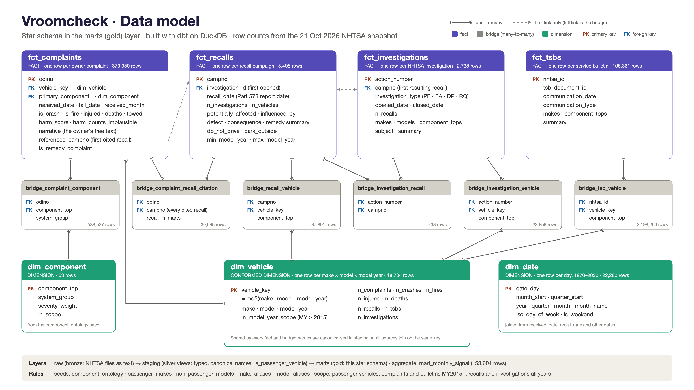
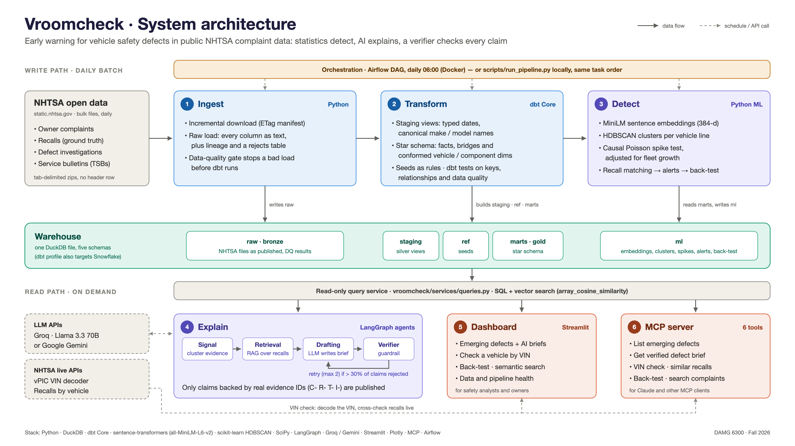
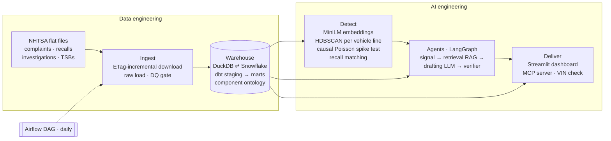

# Vroomcheck

**Early warning for vehicle safety defects hidden in public complaint data**

DAMG 6300: Gen AI with LLMs in Data Engineering, Fall 2026. Rudrang Gade, Ethan Gomes, Akshit Verma.

> **Business question:** Can we detect emerging safety defects from public complaints early
> enough to act before a recall, with every alert traceable to evidence?

Statistics detect, AI explains, and a verifier checks every claim.

---

## 1. Actual data in the project (snapshot of 21 Oct 2026)

| Layer | Table | Rows |
|---|---|---:|
| raw | `raw_complaints` | 1,114,946 |
| raw | `raw_recalls` | 246,253 |
| raw | `raw_investigations` | 154,439 |
| raw | `raw_tsbs` | 5,309,250 |
| marts | `fct_complaints` (in scope: passenger vehicles, MY2015+) | 373,323 |
| marts | `fct_recalls` (vehicle recall campaigns since 2010) | 13,701 |
| marts | `fct_investigations` | 5,351 |
| marts | `fct_tsbs` (bulletins touching MY2015+) | 128,600 |
| marts | `dim_vehicle` (777 makes, 4,781 make-model lines) | 16,372 |
| ml | `complaint_embeddings` (384-d MiniLM) | 350,772 |
| ml | `clusters` / `cluster_members` | 1,846 / 96,777 |

Freshness: latest complaint received 2026-10-19, latest recall 2026-10-16.
Warehouse size is 1.4 GB (DuckDB). Raw downloads are 3.8 GB.

## 2. Data sources and how they are collected

All data is public and comes from NHTSA. Field layouts are in [docs/nhtsa_layouts](docs/nhtsa_layouts).

| Dataset | Source file(s) | Role |
|---|---|---|
| Owner complaints | `static.nhtsa.gov/odi/ffdd/cmpl/COMPLAINTS_RECEIVED_{2015-2019,2020-2024,2025-2026}.zip` | **Early signal**: free-text narratives |
| Recalls | `.../rcl/FLAT_RCL_POST_2010.zip` | **Ground truth** for back-testing |
| Investigations | `.../inv/FLAT_INV.zip` | **Timeline check**: when NHTSA itself opened a probe |
| Service bulletins | `.../tsbs/TSBS_RECEIVED_{...}.zip` | **Extra evidence** for the briefs |
| vPIC VIN decoder | `vpic.nhtsa.dot.gov/api/vehicles/DecodeVinValues/{vin}` | VIN to make, model and year (live) |
| Recalls API | `api.nhtsa.gov/recalls/recallsByVehicle` | Live cross-check of warehouse recalls |

Collection runs in [vroomcheck/ingestion](vroomcheck/ingestion):
1. **`download.py`** streams each zip and keeps an ETag manifest, so only files that NHTSA has republished get downloaded again.
2. **`load_raw.py`** loads the tab-delimited files into `raw.*` as VARCHAR, adds lineage columns, and keeps unparseable rows in `raw._load_rejects` (currently 0).
3. **`quality_checks.py`** is a data-quality gate of 19 checks that writes to `raw._dq_results`. If a critical check fails, the pipeline stops before dbt runs. The same checks run on Snowflake RAW (`--target snowflake`), and a full `load_raw_snowflake.py` load ends with them.

## 3. Data model



The full ER diagrams are in [docs/data_model.md](docs/data_model.md). In short:

* **Star schema (gold)**: `fct_complaints`, `fct_recalls`, `fct_investigations` and `fct_tsbs`, joined through bridge tables to the conformed `dim_vehicle` (key: `md5(make|model|year)`) and `dim_component` (the component ontology seed).
* **Explicit links in the data**:
  * investigation to recall, via `CAMPNO`
  * complaint to recall, via `referenced_campno`, pulled out of the narrative text (28,089 complaints cite a campaign)
* **ML layer**: embeddings, clusters, monthly spike scores, recall matches, alerts and back-test results.

## 4. Architecture



Simplified flow:



**Detection (`vroomcheck/detection`)**
* `embed.py`: strips call-centre boilerplate ("THE CONTACT OWNS A…"), then embeds narratives with `all-MiniLM-L6-v2` on the GPU (~860 texts/s on an RTX 3060, ~38 texts/s on CPU). Runs incrementally.
* `cluster.py`: one HDBSCAN run per vehicle line (make + model, model years pooled), after PCA to 32 dimensions. Each cluster gets a keyword label from class-based TF-IDF. Clusters regularly mix component labels, which shows owners file the same failure under different components (median component purity is 64%).
* `spike.py`: a causal test. It compares the last 3 months with a 12-month baseline, adjusts for fleet growth of the rest of the vehicle line, and runs a Poisson tail test. Clusters are then linked to recalls in two ways:
  * **cited**: at least 20% of the cluster's complaints cite the campaign number
  * **semantic**: cosine similarity, re-ranked with component agreement and timing

  The result is one status per cluster: `EMERGING`, `RECALLED`, `WATCH` or `NON-DEFECT`.
* `indicator.py`: the fleet-normalised D/P indicator from ESV26-289 (see *Research paper implementation* below), scored for every make × model × component per month.
* `model_years.py`: the paper's binomial test, naming the model years each cluster is concentrated in.
* `backtest.py`: answers competency question 04 against historical recalls.
* `compare.py`: reruns the back-test under each detector (`VC_DETECTOR` = `poisson`, `paper`, `combined` or `either`) and prints the before/after table.

**Agents (`vroomcheck/agents/graph.py`, LangGraph)**
1. `signal_agent` pulls cluster statistics plus the most representative and most harmful complaints.
2. `retrieval_agent` (RAG) finds the most similar past recalls from any manufacturer, plus recalls, TSBs and investigations on the same vehicle line.
3. `drafting_agent` has Llama 3.3 70B (via Groq) or Gemini write a JSON brief in which every claim cites typed IDs (`C-`, `R-`, `T-`, `I-`).
4. `verifier_agent` is the guardrail. It rejects claims whose IDs are missing or unknown, and claims the LLM judge finds unsupported. If more than 30% of claims are rejected, the graph loops back to drafting (at most 2 attempts). Only verified claims are published.

With no API key, drafting falls back to a deterministic template and the verifier still runs.

## 5. Tech stack

| Concern | Pitch | Implemented now |
|---|---|---|
| Ingestion | Python loaders, Airflow | Python loaders ✅, Airflow DAG ✅ ([airflow/](airflow); Docker, since Airflow does not run natively on Windows) and an equivalent local runner `scripts/run_pipeline.py` |
| Warehouse | Snowflake, Iceberg | DuckDB locally ✅. dbt `snowflake` target configured in `profiles.yml` (needs credentials) |
| Transform | dbt Core | dbt Core 1.12: 4 staging views, 14 mart tables, 5 seeds, 63 tests ✅ |
| Embeddings | sentence-transformers, HDBSCAN | sentence-transformers 6.2 + scikit-learn HDBSCAN ✅ |
| Agents and RAG | LangGraph | LangGraph 1.2, with RAG via DuckDB `array_cosine_similarity` ✅ |
| LLMs | Llama (Groq), Gemini | Groq and Gemini clients ✅. **Needs `GROQ_API_KEY` in `.env`** |
| Integration | MCP server | `mcp_server/server.py`, 6 tools ✅ |
| Interface | Streamlit | `app/streamlit_app.py`, 6 views ✅ |

## 6. Current results

**Competency Q1: emerging, unrecalled patterns.** 106 clusters are EMERGING (643 are RECALLED, 1,044 WATCH, 53 NON-DEFECT). The top of the list includes:
* Jeep Wrangler 4xe: loss of power in electric mode
* Honda Prologue: automatic braking
* Toyota Tacoma: door handles
* Acura MDX / TLX: transfer-case leaks
* Jeep Grand Cherokee: forward-collision false braking
* Ford F-250 SD: engine-bay smoke and flames
* VW ID.4: unintended acceleration while parking

**Competency Q2: VIN check.** Warehouse recall counts match the live NHTSA Recalls API exactly in spot checks (2021 Wrangler 15/15, 2020 Model Y 24/24, 2020 F-150 11/11).

**Competency Q3: similar past recalls.** For clusters whose complaints cite a campaign number, the correct recall is the top semantic match for 46% of clusters (89 labelled clusters; 27% before re-ranking with component agreement and timing).

**Competency Q4: back-test**, over 7,570 in-scope recalls since 2017. 439 of them are detectable, meaning they have a matched cluster with at least 5 complaints before the recall.

| Metric | Target | Now |
|---|---|---|
| Past recalls flagged before the recall date (of detectable) | ≥ 50% | **35%** (152 of 439) ❌ |
| Median early-warning lead time | ≥ 3 months | **9.1 months** ✅ |
| Lead over NHTSA opening an investigation (median) | none | **11.1 months** |
| Brief claims that cite a real ID | 100% | **100%** ✅ (enforced by the verifier) |

Tuning history:
* Spike test: going from thresholds 6 / 2.5 / 1e-3 to 4 / 2.0 / 1e-2 raised coverage from 29% to about 51% when any earlier alert counted.
* With the stricter rule that an alert must fall within the 24 months before the recall, coverage is 35%.

**Known limitations.** Clusters are built on the full history, so cluster membership uses some post-recall information. The spike test itself is strictly causal. Clusters cover about 29% of complaints; the rest is HDBSCAN noise.

### Research paper implementation: ESV26-289

Paper: Jones, Kempegowda, Krivo and Ng, *A Check Engine Light for the Automotive Industry: Detecting Automotive Failures from Consumer Complaints and Online Forums*, NHTSA ESV ([ESV26-289](https://static.nhtsa.gov/esv/pdf/ESV/Proceedings/28/ESV26-289.pdf)).

What we took from it:
* **The D/P indicator** (`detection/indicator.py`). For each vehicle line and component, the vehicle's share of its own complaints is compared with the rest of the fleet's share using Cohen's h, scaled by ln(trailing-year count), and mapped to P in (-1, 1). An alert needs the paper's sustained-elevation test: the 6-month mean of 0.5(P+1) above 0.65 at 99% confidence, with more than 3 complaints in the trailing year. Flags under 12 months apart merge into events. The original Poisson test only compares a cluster with its own past; the indicator compares the vehicle with the rest of the fleet, so a best-seller is not flagged just for selling a lot.
* **The binomial model-year test** (`detection/model_years.py`): the affected model years of each alert.

Choices the paper leaves open, and ours: monthly instead of daily windows (6 months for 180 days); the vehicle's own complaint share; Cohen's h as the effect size for proportions; natural log; the vehicle left out of its own baseline.

Before vs after, same clusters, recalls and back-test window (`python -m vroomcheck.detection.compare`):

| Detector | Flagged early (of 440) | Median lead | EMERGING alerts | Alert months per 1,000 | Alerts then recalled | Detect step |
|---|---|---|---|---|---|---|
| `poisson` (before) | 153 (34.8%) | 9.0 mo | 108 | 17.2 | 10.5% | 4.5 s |
| `paper` | 194 (44.1%) | 20.2 mo | 433 | 204.2 | 10.0% | 4.6 s |
| `combined` (both) | 59 (13.4%) | 11.5 mo | 43 | 6.5 | 11.7% | 4.6 s |
| `either` | 254 (57.7%) | 17.2 mo | 485 | 214.9 | 10.4% | 4.7 s |

The indicator itself takes 0.6 s for the whole fleet. It finds more recalls in advance, but it flags vehicle-component pairs that stay elevated for years, so it raises about 12 times as many alert months without improving the share of alerts followed by a recall. Requiring both signals has the reverse trade-off. `poisson` stays the default; `either` is the choice if catching more recalls matters more than review workload.

Affected model years against the years each matched recall covers (663 recalled clusters):

| Method | Years named | Precision | Recall | Jaccard |
|---|---|---|---|---|
| Cluster span (before) | 7.6 | 0.355 | 0.967 | 0.338 |
| Binomial test (after) | 2.9 | 0.540 | 0.545 | 0.362 |

As in the paper, the binomial test is conservative: it names fewer years, and more of them are right.

Limitation found while testing: complaint shares sum to one, so a surge in one component lowers every other component's baseline. With about a thousand vehicle lines the effect is small, but in a small fleet it produces false flags (see `tests/test_core.py`).

**Next steps**
* Rolling (time-sliced) re-clustering to remove the post-recall leakage above.
* Use a recall's affected-population size (POTAFF) to normalise rates.
* LLM-written cluster labels.
* Snowflake deployment.

## 7. How to run

```bash
python -m venv .venv
.venv/Scripts/python -m pip install -r requirements.txt
# optional GPU: .venv/Scripts/python -m pip install torch==2.14.1 --index-url https://download.pytorch.org/whl/cu130
cp .env.example .env            # add GROQ_API_KEY for LLM briefs
.venv/Scripts/python scripts/run_pipeline.py              # full pipeline, ~25 min on GPU
.venv/Scripts/python scripts/run_pipeline.py --from detect # re-score only
.venv/Scripts/streamlit run app/streamlit_app.py           # dashboard at http://localhost:8501
.venv/Scripts/python -m pytest -q tests                    # unit tests
```

**Getting the data without rebuilding it.** The NHTSA zips (291 MB) and the built warehouse (1.4 GB) are too large for git. They are published as assets of the [`data-2026-10-21` release](https://github.com/AkshitVerma-AV/vroomcheck/releases/tag/data-2026-10-21) instead. With the GitHub CLI logged in:

```bash
.venv/Scripts/python scripts/fetch_data_snapshot.py                 # zips + ready-built warehouse: open the dashboard straight away
.venv/Scripts/python scripts/fetch_data_snapshot.py --no-warehouse  # zips only, then: scripts/run_pipeline.py --from load
```

The MCP server is registered in [.mcp.json](.mcp.json) and starts with `python -m mcp_server.server`. Its tools:
* `list_emerging_defects`
* `get_defect_brief`
* `check_vin`
* `similar_past_recalls`
* `backtest_summary`
* `search_complaints`

Step timings on an RTX 3060 laptop:

| Step | Time |
|---|---|
| Download | ~2 min |
| Raw load | ~50 s |
| dbt (seed, run, test) | ~1.5 min |
| Embed | ~10 min |
| Cluster | ~4 min |
| Detect, back-test and briefs | ~1.5 min |

## 8. Demo script (≈10 min)

1. **Data**: open *Data & pipeline* and show the row counts by layer and the DQ gate. Open `data/landing` and one raw narrative.
2. **Model**: walk through [docs/data_model.md](docs/data_model.md) and the dbt lineage (`dbt docs generate && dbt docs serve` in `dbt/vroomcheck`).
3. **Pipeline**: show [airflow/dags/vroomcheck_dag.py](airflow/dags/vroomcheck_dag.py), then run `scripts/run_pipeline.py --from detect` live.
4. **Detect**: open *Emerging defects* and pick the Jeep Wrangler cluster. Show the spike chart, the representative complaints and the similar past recalls.
5. **Explain**: click *Generate brief*. Show the agent trace, the cited evidence and the rejected claims.
6. **Check a vehicle**: enter a VIN.
7. **Prove it**: open *Back-test*, show the lead-time histogram and pick a recall to see its alert timeline.
8. **Integration**: call the MCP tools from Claude, e.g. `check_vin`.

## Repository layout

```
vroomcheck/       python package: config, db, ingestion/, detection/, agents/, services/
dbt/vroomcheck/   dbt project: staging, marts, seeds (component ontology, vehicle scope, name aliases), tests, macros
airflow/          DAG + docker-compose
mcp_server/       MCP server
app/              Streamlit dashboard
scripts/          local pipeline runner
tests/            unit tests (spike causality, ESV26-289 indicator and model years, verifier guardrail, cleaning)
docs/             data model, NHTSA field layouts
```
