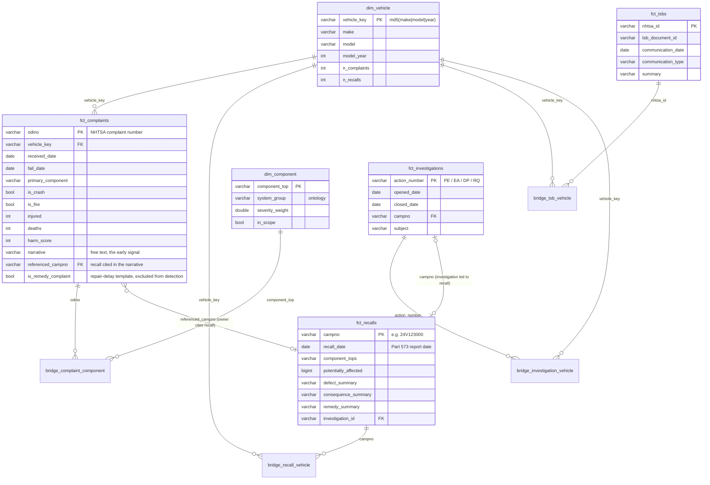
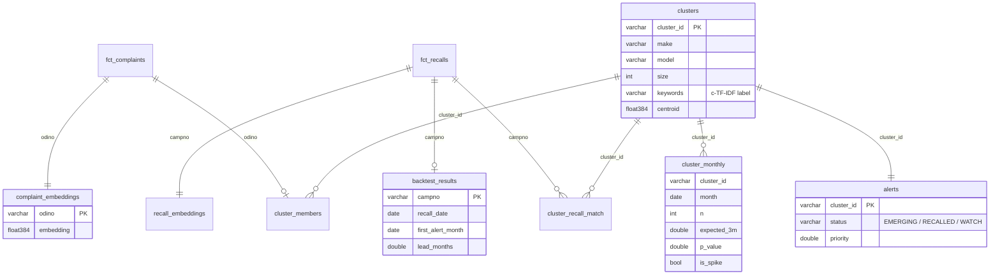

# Vroomcheck data model

The warehouse has four layers. Each layer is a schema in the same DuckDB file
(`warehouse/vroomcheck.duckdb`). The same dbt project builds the same
schemas in Snowflake when run with `VC_DBT_TARGET=snowflake`.

| Layer | Schema | Built by | Purpose |
|---|---|---|---|
| Bronze | `raw` | `vroomcheck/ingestion/load_raw.py` | NHTSA flat files as published, all VARCHAR, plus lineage columns `_source_file` and `_loaded_at`. Also holds `_dq_results` and `_load_rejects`. |
| Silver | `staging` | dbt views `stg_*` | Typed dates and integers, normalised make/model names, component path split into top-level component. |
| Gold | `marts` | dbt tables | Star schema: facts, bridges and conformed dimensions, restricted to the project scope. |
| ML | `ml` | `vroomcheck/detection/*` | Embeddings, clusters, monthly spike scores, recall matches, alerts and back-test results. |
| Ref | `ref` | dbt seeds | `component_ontology`, `non_passenger_makes`. |

## Gold layer (star schema)

**Grain**
* `fct_complaints`: one row per complaint (ODINO). In the raw file a complaint
  that names three components appears as three rows. The extra rows go into
  `bridge_complaint_component`.
* `fct_recalls`: one row per recall campaign (CAMPNO). The affected vehicles
  go into `bridge_recall_vehicle`, one row per campaign × make/model/year × component.
* The vehicle key is `md5(make|model|model_year)`. Complaints, recalls, TSBs
  and investigations all join on it after name normalisation (`norm_name` macro).

**Scope rules** (pitch slide 8), applied in `fct_complaints`:
* product type is vehicle (`PROD_TYPE = 'V'`), model year 2015 or later, received 2015 or later
* complaints about tires, child seats or equipment only are dropped, using `component_ontology.in_scope`
* RVs, motorcycles and heavy trucks are dropped, using the `non_passenger_makes` seed

## ML layer

## Data quality

| Where | Check |
|---|---|
| Ingestion gate (`raw._dq_results`) | row counts, primary-key nulls, unparseable dates, load rejects, missing narratives, future dates, CAMPNO format |
| dbt tests | unique and not-null keys on every fact and dimension, referential integrity between bridges and facts, accepted investigation types, investigation close date not before open date (warn), complaint received no more than 2 years before its model year (warn) |
