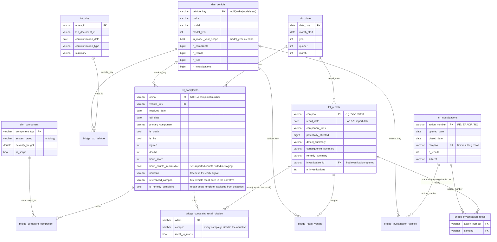
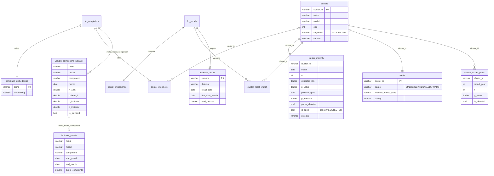

# Vroomcheck data model

The warehouse has four layers. Each layer is a schema in the same DuckDB file
(`warehouse/vroomcheck.duckdb`). The same dbt project builds the same
schemas in Snowflake when run with `VC_DBT_TARGET=snowflake`.

| Layer | Schema | Built by | Purpose |
|---|---|---|---|
| Bronze | `raw` | `vroomcheck/ingestion/load_raw.py` | NHTSA flat files as published, all VARCHAR, plus lineage columns `_source_file` and `_loaded_at`. Also holds `_dq_results` and `_load_rejects`. |
| Silver | `staging` | dbt views `stg_*` | Typed dates and integers, canonical make/model names, component path split into top-level component, `is_passenger_vehicle` flag. |
| Gold | `marts` | dbt tables | Star schema: facts, bridges and conformed dimensions, restricted to the project scope. |
| ML | `ml` | `vroomcheck/detection/*` | Embeddings, clusters, monthly spike scores, recall matches, alerts and back-test results. |
| Ref | `ref` | dbt seeds | `component_ontology`, `passenger_makes`, `non_passenger_models`, `make_aliases`, `model_aliases`. |

## Gold layer (star schema)

**Grain**
* `fct_complaints`: one row per complaint (ODINO). In the raw file a complaint
  that names three components appears as three rows. The extra rows go into
  `bridge_complaint_component`. `primary_component` is the most severe of them
  (ties broken alphabetically) and `primary_system` is that component's group.
* `fct_recalls`: one row per recall campaign (CAMPNO). The affected vehicles
  go into `bridge_recall_vehicle`, one row per campaign × make/model/year × component.
* The vehicle key is `md5(make|model|model_year)`. Complaints, recalls, TSBs
  and investigations all join on it after name normalisation (`norm_name`,
  `norm_model`, and the `make_aliases` / `model_aliases` seeds, e.g. `GLA250` → `GLA 250`).
  `dim_vehicle` holds every vehicle any fact or bridge references, and every
  `vehicle_key` is tested against it.
* Investigations and recalls are many-to-many (`bridge_investigation_recall`).
  `fct_recalls.investigation_id` / `fct_investigations.campno` keep the first link
  for convenience.

**Scope rules** (pitch slide 8). One vehicle-type rule for every table, computed once in staging
as `is_passenger_vehicle` (`macros/vehicle_scope.sql`):
* the make is on the `passenger_makes` allow-list (current and defunct passenger brands;
  RV, bus, trailer, motorcycle and truck makers are not on it), and
* the model does not match `non_passenger_models` (motorcycles, medium-duty trucks and stripped
  chassis sold under a passenger make, e.g. Honda Gold Wing, BMW R 1250 GS, Ford F-53 / F-650).

Model-year window, per table:
* `fct_complaints`: product type vehicle (`PROD_TYPE = 'V'`), model year 2015 or later, received
  2015 or later; complaints about tires, child seats or equipment only are dropped using
  `component_ontology.in_scope`.
* `fct_tsbs` / `bridge_tsb_vehicle`: model year 2015 or later.
* `fct_recalls`, `fct_investigations` and their bridges: all model years (the VIN check and the
  investigation timeline need older vehicles). `dim_vehicle.in_model_year_scope` marks MY2015+.

Self-reported injury counts above 20 and death counts above 10 (owners type the field maximum, 99,
in protest) are treated as unknown in staging and flagged with `harm_counts_implausible`.

## ML layer

The ML layer lives in Snowflake schema `VROOMCHECK.ML`, with embeddings and cluster
centroids stored as `VECTOR(FLOAT, 384)`. Embeddings, clusters, members and briefs are
permanent tables; everything that can be rebuilt from them is transient.

`vehicle_component_indicator`, `indicator_events` and `cluster_model_years` implement
the method of ESV26-289 (Jones et al., *A Check Engine Light for the Automotive Industry*):
the fleet-normalised D/P indicator with its 6-month sustained-elevation test, event
merging, and the binomial test for affected model years. `ml.detector_comparison`
holds the before/after back-test from `python -m vroomcheck.detection.compare`, and
`ml_before` keeps the original detector's results.

## Data quality

| Where | Check |
|---|---|
| Ingestion gate (`raw._dq_results`) | row counts, primary-key nulls, unparseable dates, load rejects, missing narratives, future dates, CAMPNO format |
| dbt tests | unique and not-null keys on every fact, dimension and seed; referential integrity from every bridge to its fact and to `dim_vehicle`, between investigations and recalls, and from fact dates to `dim_date`; harm counts within plausible limits; accepted investigation types (warn); investigation close date not before open date (warn); complaint received no more than 2 years before its model year (warn); failure date not after received date (warn); near-duplicate model names that should be aliased (warn); cited vehicle campaigns that do not exist (warn) |
